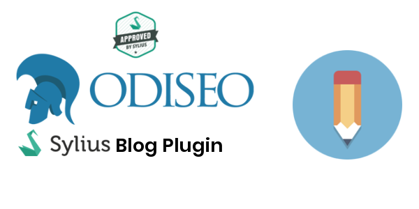

    

## Description

This plugin adds a blog to your Sylius store.

For Sylius 1.x, use the [`1.4`](https://github.com/odiseoteam/SyliusBlogPlugin/tree/1.4) branch.

## Documentation

- **[Installation](doc/installation.md)**

## Demo

Want a live walkthrough of this plugin? [Get in touch](https://odiseo.io/en/contact-us?utm_source=github&utm_medium=readme&utm_campaign=sylius-blog-plugin) — or browse all our Sylius plugins at [odiseo.io](https://odiseo.io/en/products/sylius-plugins?utm_source=github&utm_medium=readme&utm_campaign=sylius-blog-plugin).

## Credits

This plugin is maintained by [Odiseo](https://odiseo.io/en?utm_source=github&utm_medium=readme&utm_campaign=sylius-blog-plugin). Want us to help you with this plugin or any Sylius project? [Get in touch](https://odiseo.io/en/contact-us?utm_source=github&utm_medium=readme&utm_campaign=sylius-blog-plugin).
